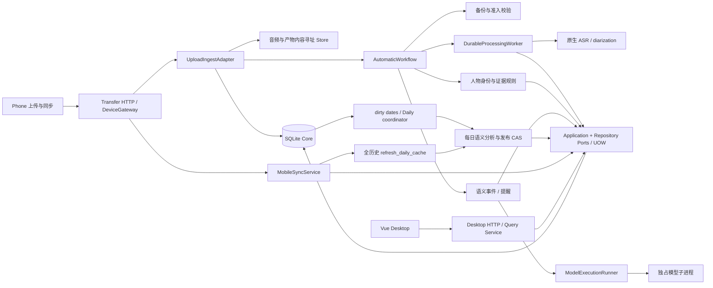

# Project Engineering Audit

审计日期：2026-10-07（Asia/Singapore）。基线：`87532be`，审计开始时已跟踪文件无未提交修改。

范围：当前 AllDayRecording-ASR 仓库的 Python 后端、Vue 桌面前端、契约、迁移、测试、工具及 Git 历史。相邻 Harmony 仓库只执行跨仓库契约核验，**本报告不是 Phone/Watch 实现的全面审计**。未访问生产数据库内容、未运行真实模型、未进行历史回放或设备操作。

方法：对全部生产 Python 文件做 AST/规模/依赖扫描，阅读架构和整改文档，沿主要业务链路检查实现，深入阅读高复杂度和高变更区域，运行现有测试，并用临时数据库、fake 模型及确定性交错脚本验证关键问题。不是逐行形式化验证；下文区分“已复现”“静态确认”和“条件性风险”。既有整改报告仅作历史参考，不代替本轮验证。

引用约定：`A/` 指 `src/allday_asr/v3/`，`F/` 指 `all_day_recording_front/`，`T/` 指 `tests/`。源码引用附当前基线的行号。复杂度指标与临时实验输出保存在 `outputs/engineering-audit/`，该目录被 Git 忽略。

## 1. Executive Summary

**项目有可继续发展的工程基础，但还不能认为核心一致性和长期运行已经全面闭环。建议 Level 2——有针对性的模块级重构，边开发边治理。**

它不是整体失控的“屎山”：显式组合根、领域对象、仓储端口、SQLite Unit of Work、内容寻址文件、版本化契约和大量行为测试都真实存在；新旧架构已经有明确切分。最值得保留的是证据、版本、用户确认意图和持久任务这些基本设计。

不过，“文件都小于 600 行”“测试全部通过”“整改验收完成”均不足以证明语义正确。目前出现了局部堆积：同一业务通过多个状态载体表达，Mixin 将一个对象的实现分散到多文件，新增安全机制没有总是与调用方生命周期对齐。已复现的缺陷恰好发生在这些边界。

最大的三个风险：

1. **证据版本被错误归属（R1，P0）**：模型读取 revision 1 后，用户修改成 revision 2；旧模型结论仍被自动接受，证据依赖却写成 revision 2。这是事实与来源错配，不是风格问题。
2. **模型预算的身份生命周期错误（R2，P1）**：录音 session ID 被用作永久 batch ID。首次调用 30 分钟后，即使是新的输入修订，也会遇到旧批次过期；重启不会解除。
3. **同步请求仍串行刷新全历史每日缓存（R3，P1）**：后台已经增量化，但手机同步入口仍逐日处理全部历史；随使用时间增长，同步延迟和数据库负载会增长。

另外，手动重试存在崩溃丢请求窗口（R4）；本地 ASR 推理没有可终止的执行期限（R5）；异常关联日志和测试覆盖存在明确缺口。

**Overall Engineering Health：6.3/10。** 可以继续开发 6～12 个月，但应先关闭 R1 的写入竞态，并在近期完成 R2～R4。无需停掉整个项目来替换数据库、Web 框架或模型链路。

## 2. Architecture Overview

### 2.1 模块与责任

| 目录 | 实际职责 | 审计判断 |
|---|---|---|
| `src/allday_asr/cli.py`、`A/interfaces/cli.py` | CLI 分发、启动/诊断命令 | 外层入口；历史高频不等于当前高复杂度 |
| `A/bootstrap/` | 组装数据库、store、应用服务、模型适配器、后台 owner | 主要依赖汇聚点合理；少量 private 属性/回调形成隐式连接 |
| `A/domain/` | 录音/处理/知识/身份模型、纯规则、每日语义校验 | 大体独立；`dataset_roles.py` 实际执行 SQL，是残留跨层 |
| `A/ports/` | 仓储、UOW、模型生成、ASR/embedding 接口 | 有替换与测试接缝；部分能力仍未完整类型化 |
| `A/application/` | 处理任务、同步、修订失效、人物身份、事件、提醒、每日生成 | 核心行为清楚；人员/知识/洞察多用 Mixin 共享对象内部状态 |
| `A/adapters/sqlite/` | 持久化、复杂投影查询、迁移、队列 | SQL 主要集中于此；JSON 投影与 trigger 承载较多业务约定 |
| `A/adapters/transfer/` | 文件上传转业务实体、自动备份/处理/后处理流水线 | 既做适配又做业务编排，成为跨模块热点 |
| `A/adapters/models/`、`speaker_embeddings/` | 原生 ASR、diarization、声纹计算及快照选择 | 接口可替换；执行隔离与取消边界不完整 |
| `A/adapters/codex/` | 模型请求、schema、独占子进程、receipt/预算 | 已有超时与预算，但批次身份和应用请求边界不匹配 |
| `A/interfaces/` | 桌面 HTTP、设备同步/审核 API、CLI、音频服务 | 不是纯路由层；两个大 dispatcher 和审核策略仍集中 |
| `F/v3/` | Vue 视图、API 封装、查询缓存、播放器、展示类型 | UI 不直接访问数据库；局部视图管理多套异步状态 |
| `contracts/v3/` | OpenAPI、JSON Schema、fixture、release lock | 跨端边界明确，当前字节核验通过 |
| `tests/`、`tools/`、`docs/` | 回归、研究/修复/契约工具、演进资料 | 覆盖面广；工具不能因没有应用调用就认定为死代码 |

图中“全历史 refresh_daily_cache”是仍然存在的第二条路径，不能只看新增 coordinator 就判断所有每日计算已增量化。

### 2.2 真实核心调用链

**录音接收与处理**：`DeviceGateway.upload_completed` → `V3UploadIngestAdapter.ingest_completed` → 验证 manifest/分片 → 事务外 hash、copy、fsync → 事务内核对 revision 并发布 metadata → 自动工作流 → 独立备份与 admission → `DurableProcessingService.submit` → worker 领取 stage → `NativeModelPipelineAdapter.execute` → `complete` 写入产物和投影。见 [A/interfaces/device_gateway.py:97](C:/Users/32673/PycharmProjects/AllDayRecording-ASR/src/allday_asr/v3/interfaces/device_gateway.py:97)、[A/adapters/transfer/ingest.py:65](C:/Users/32673/PycharmProjects/AllDayRecording-ASR/src/allday_asr/v3/adapters/transfer/ingest.py:65)、[A/adapters/transfer/automation.py:218](C:/Users/32673/PycharmProjects/AllDayRecording-ASR/src/allday_asr/v3/adapters/transfer/automation.py:218)、[A/application/processing_worker.py:42](C:/Users/32673/PycharmProjects/AllDayRecording-ASR/src/allday_asr/v3/application/processing_worker.py:42)、[A/application/processing_service.py:213](C:/Users/32673/PycharmProjects/AllDayRecording-ASR/src/allday_asr/v3/application/processing_service.py:213)。

**修订与同步**：设备请求 → `MobileSyncService.synchronize` → UOW 内逐项应用 operation/幂等 receipt、推进 cursor → 提交 → daily_refresh 回调 → 只读构造增量响应。人工修订通过 `apply_utterance_correction` → `invalidate_replaced_evidence` → `cascade_derivations`。已经存在的自动派生结果会 stale；用户确认任务保留意图。见 [A/application/mobile_sync.py:186](C:/Users/32673/PycharmProjects/AllDayRecording-ASR/src/allday_asr/v3/application/mobile_sync.py:186)、[A/application/processing_correction.py:106](C:/Users/32673/PycharmProjects/AllDayRecording-ASR/src/allday_asr/v3/application/processing_correction.py:106)、[A/application/evidence_replacement.py:13](C:/Users/32673/PycharmProjects/AllDayRecording-ASR/src/allday_asr/v3/application/evidence_replacement.py:13)、[A/application/knowledge_support.py:53](C:/Users/32673/PycharmProjects/AllDayRecording-ASR/src/allday_asr/v3/application/knowledge_support.py:53)。

**语义事件**：`SemanticEventExtractionService._request` 读取原文及 revision → generator → runner → 校验输出 evidence ID → `submit_generation` → `_resolve_inputs` 再读当前 revision → proposal → `_accept_event` 再读当前 revision并自动/人工接受。最后两次读取没有证明“当前 revision 就是模型实际读到的 revision”，形成 R1。见 [A/application/event_extraction.py:121](C:/Users/32673/PycharmProjects/AllDayRecording-ASR/src/allday_asr/v3/application/event_extraction.py:121)、[A/application/knowledge_queries.py:93](C:/Users/32673/PycharmProjects/AllDayRecording-ASR/src/allday_asr/v3/application/knowledge_queries.py:93)、[A/application/knowledge_resolution.py:30](C:/Users/32673/PycharmProjects/AllDayRecording-ASR/src/allday_asr/v3/application/knowledge_resolution.py:30)。

**每日生成**：source 写入触发 dirty ranges → coordinator 有界 inventory → queue observe/claim → heartbeat + `refresh_daily` → 微批语义/目标合并/概览 → 发布前比较来源与事件 hash → 一个事务发布事件及摘要 → queue finish。发布 CAS 是可靠的正例；它不自动覆盖另一条语义事件链。见 [A/adapters/sqlite/migrations/v029_daily_dirty_dates.py:1](C:/Users/32673/PycharmProjects/AllDayRecording-ASR/src/allday_asr/v3/adapters/sqlite/migrations/v029_daily_dirty_dates.py:1)、[A/application/daily_automation.py:32](C:/Users/32673/PycharmProjects/AllDayRecording-ASR/src/allday_asr/v3/application/daily_automation.py:32)、[A/application/daily_events.py:39](C:/Users/32673/PycharmProjects/AllDayRecording-ASR/src/allday_asr/v3/application/daily_events.py:39)。

**桌面审核/编辑**：Vue `desktopApi` → dispatcher → corrections/people/reminders 等应用服务 → DB 与 change log → 前端显式 invalidate/refresh。查询缓存有请求代次、取消与共享请求保护；时间线又有局部 cursor/AbortController。见 [F/v3/core/query.ts:9](C:/Users/32673/PycharmProjects/AllDayRecording-ASR/all_day_recording_front/v3/core/query.ts:9)、[F/v3/views/SessionDetailView.vue:151](C:/Users/32673/PycharmProjects/AllDayRecording-ASR/all_day_recording_front/v3/views/SessionDetailView.vue:151)、[A/interfaces/desktop_routes_post.py:52](C:/Users/32673/PycharmProjects/AllDayRecording-ASR/src/allday_asr/v3/interfaces/desktop_routes_post.py:52)。

### 2.3 依赖与状态所有权

主要方向为 interfaces/bootstrap → application → ports/domain ← adapters。没有发现 UI 直接执行数据库查询，也没有发现必须通过“大规模 service 环形网络”才能完成普通业务的证据。

但层边界不是完全成立：

- [A/domain/dataset_roles.py:16](C:/Users/32673/PycharmProjects/AllDayRecording-ASR/src/allday_asr/v3/domain/dataset_roles.py:16) 的 `require_learning/is_learning` 接受 connection 并执行 SQL。架构测试只禁止特定 import，无法发现这种 duck typing 穿透。
- [A/adapters/transfer/ingest.py:116](C:/Users/32673/PycharmProjects/AllDayRecording-ASR/src/allday_asr/v3/adapters/transfer/ingest.py:116) 使用 `uow.catalog.connection.execute`；它虽位于 adapter 层，仍绕过了 catalog port，替换 repository 时需要额外改 ingest。
- [A/application/daily_automation.py:13](C:/Users/32673/PycharmProjects/AllDayRecording-ASR/src/allday_asr/v3/application/daily_automation.py:13) 接收未类型化 database，并要求它提供 path、inventory factory、queue factory、dirty-range 能力；不是一个完整显式的 application port。
- [A/bootstrap/core.py:219](C:/Users/32673/PycharmProjects/AllDayRecording-ASR/src/allday_asr/v3/bootstrap/core.py:219) 读取 `insights._daily_analyzer`，[A/application/daily_event_inputs.py:2](C:/Users/32673/PycharmProjects/AllDayRecording-ASR/src/allday_asr/v3/application/daily_event_inputs.py:2) 导入 event extraction 的私有 `_utterance`。这些是具体的内部实现耦合。

包含相对导入和函数内导入的 AST 图发现 4 组静态强连通分量：migration_runner↔migrations；desktop repository/包导出/UOW；speaker/sound annotation↔processing correction/facade；daily analyzer↔bounded worker。它们含延迟导入或 facade/子进程用途，当前完整导入与测试成功，**不能把静态环直接解释为运行时循环导入故障**。其中 annotation 的 facade 回引更值得在修改时收口，迁移注册的延迟导入暂不必动。

| 数据/状态 | 权威来源 | 其他载体与约束 |
|---|---|---|
| 原音/manifest | 内容寻址文件 + SQLite 引用 | stage 后事务失败可留下不可变孤儿文件；不等于丢失已提交证据 |
| utterance | SQLite 当前 revision + correction history | UI/模型输入是快照，提交派生结果必须校验快照版本 |
| 事件/提醒 | operations、current state、dependencies、schedule | 多张表是有意的历史/投影分离，不应一概合并 |
| 原生处理 | processing jobs/runs/stages/attempts/leases | automation JSON 又表示全流水线完成情况；二者含义必须区分 |
| 每日生成 | daily queue + summary/event revisions + dirty ranges | 模型 receipt/cache 是执行证据；不能单独证明业务已发布 |
| 前端 | 服务端数据 + useQuery cache + 视图局部状态 | 显式失效，非自动全局一致；TTL 也不是缓存容量上限 |

## 3. Scorecard

分数是基于当前规模和未来 6～12 个月演进的工程判断，不是测试通过率或自动工具评级；整体分数取下表平均后四舍五入。

| 项目 | 分数 | 说明 |
|---|---:|---|
| Architecture | 7.0 | 分层/组合根/UOW 成立；R1、R3 显示同类一致性规则未全面贯通 |
| Modularity | 6.0 | 有 port；17 个类通过 Mixin 组合，部分 facade、私有函数和 connection 穿透 |
| Maintainability | 6.0 | 能定位业务，但状态演进往往同时改队列、投影、UI 和工具；模拟见第 6 节 |
| Readability | 6.5 | 领域名清晰；daily inventory、目标合并、审核查询认知负担明显 |
| Testability | 7.5 | 临时 SQLite、fake provider、注入 clock、UOW 支持真实行为验证；Python 无正式类型检查 gate |
| Reliability | 6.0 | 崩溃恢复/幂等基础较好；R2、R4 存在可复现的恢复和重新执行缺口 |
| Error Handling | 5.5 | 有结构化错误、有限重试；HTTP 与 daily 的宽泛 catch 丢失内部错误上下文 |
| Data Model | 7.0 | 版本、依赖、操作历史、迁移 checksum 完整；R1 证明 provenance 使用仍可出错 |
| Concurrency Safety | 5.5 | BEGIN IMMEDIATE、lease token、CAS 有效；生成快照竞态与本地推理取消缺口 |
| Observability | 5.5 | job/run/attempt、审计表、receipt 很有用；request ID 无法总是关联堆栈 |
| Extensibility | 6.5 | 新模型后端接缝好；Daily/身份/审核规则增加时改动放大明显 |

**Overall Engineering Health：6.3/10。**

## 4. Top Engineering Risks

### R1 — 旧模型结论被绑定到新证据 revision

- **Severity：P0；已复现。** 此处按本次审计定义，P0 指可能造成数据错误的核心一致性问题，不代表全站不可用。
- **File / Function**：[A/application/event_extraction.py:121](C:/Users/32673/PycharmProjects/AllDayRecording-ASR/src/allday_asr/v3/application/event_extraction.py:121) `extract`；[A/application/knowledge_queries.py:93](C:/Users/32673/PycharmProjects/AllDayRecording-ASR/src/allday_asr/v3/application/knowledge_queries.py:93) `_resolve_inputs`；[A/application/knowledge_resolution.py:129](C:/Users/32673/PycharmProjects/AllDayRecording-ASR/src/allday_asr/v3/application/knowledge_resolution.py:129) `_accept_event`；[A/adapters/sqlite/knowledge_repository_events.py:18](C:/Users/32673/PycharmProjects/AllDayRecording-ASR/src/allday_asr/v3/adapters/sqlite/knowledge_repository_events.py:18) `utterance_revisions`。
- **Evidence**：请求中有 revision，但 `GenerationSubmission.input_scope` 主要携带 utterance IDs，提交/接受时重新读取当前 revision，未比较模型读取版本。确定性交错：fake generator 收到 revision 1 → 调用真实 correction service 改为 revision 2 → 返回旧“采用方案”结论。结果 `auto_accepted_count=1`，event 和 derivation 均 active，dependency/evidence_revision 却为 2。
- **为什么是问题**：在 inference 或人工等待期间发生的修订，早于新 event 建立依赖；此前的失效级联无法找到尚不存在的 event。之后给旧结论附上新版本，会掩盖已过期来源。
- **后果**：修改后的原文与自动提炼事实相矛盾，却被查询层视为当前有效。类似 revision 重读也存在于 memory 接受路径，但本轮运行复现限定为语义事件。
- **修复难度：中。现在处理：是。** 将生成时输入 revision/status 快照作为正式提交前置条件，在提交和接受事务内验证；过期结果应冲突/待重生成，不得自动变成新事实。无需长时间持有 DB 锁，也无需推翻依赖模型。
- **验证记录**：`outputs/engineering-audit/reproduce.py` 与 `reproduction.json`。另需补“proposal 已提交但未接受时原文变化”的测试，覆盖两个时间窗口。

### R2 — session 级永久批次阻止后续修订生成

- **Severity：P1；已复现 runner 行为并核对真实调用参数。**
- **File / Function**：[A/adapters/codex/event_generator.py:141](C:/Users/32673/PycharmProjects/AllDayRecording-ASR/src/allday_asr/v3/adapters/codex/event_generator.py:141)、[A/adapters/codex/reminder_generator.py:156](C:/Users/32673/PycharmProjects/AllDayRecording-ASR/src/allday_asr/v3/adapters/codex/reminder_generator.py:156) `generate`；[A/adapters/codex/insight_generator.py:130](C:/Users/32673/PycharmProjects/AllDayRecording-ASR/src/allday_asr/v3/adapters/codex/insight_generator.py:130)；[A/adapters/codex/model_execution_runner.py:101](C:/Users/32673/PycharmProjects/AllDayRecording-ASR/src/allday_asr/v3/adapters/codex/model_execution_runner.py:101) `run`。
- **Evidence**：事件/提醒均传 `batch_id=request.session_id`；生产 receipt 目录也共用约定。batch 文件保存首次 started_at/deadline，后续不同 prompt 仍读同一 batch。实验首次调用 clock=1000 成功；clock=2801、同 session 新 prompt，零远程调用即报 `model batch budget exhausted`。完全相同的完成 job 会命中缓存，这不解决新 revision。
- **为什么是问题**：有限执行批次与长期业务实体身份混为一谈。预算保护本身正确，作用域错误；event/reminder 还可能共享同 session 预算。
- **后果**：晚到的音频、人工修订、次日重做等正常动作被永久过期批次拒绝。外层 automatic retry 不能更换 batch，重启也不解决；UI 的“重试”可能反复失败。
- **修复难度：中。现在处理：是。** 明确一次业务 generation/batch 的身份，包含任务类别与输入修订；同一次执行的重启/重试必须继续沿用旧预算，新的已授权生成才有新批次。不得简单删除 receipt 或给每次 retry 随机新 ID，避免绕过预算。

### R3 — 增量 coordinator 之外仍有同步全历史扫描

- **Severity：P1；静态链路确认，规模调用实验确认。**
- **File / Function**：[A/bootstrap/core.py:221](C:/Users/32673/PycharmProjects/AllDayRecording-ASR/src/allday_asr/v3/bootstrap/core.py:221) `daily_refresh` → [A/application/mobile_sync.py:207](C:/Users/32673/PycharmProjects/AllDayRecording-ASR/src/allday_asr/v3/application/mobile_sync.py:207) → [A/application/daily_events.py:23](C:/Users/32673/PycharmProjects/AllDayRecording-ASR/src/allday_asr/v3/application/daily_events.py:23) `refresh_daily_cache` → [A/adapters/sqlite/daily_source_repository.py:13](C:/Users/32673/PycharmProjects/AllDayRecording-ASR/src/allday_asr/v3/adapters/sqlite/daily_source_repository.py:13) `daily_source_starts`。
- **Evidence**：同步提交后、返回响应前调用 refresh。`daily_source_starts` 查询全部 active utterance 的不同 start_at；逐日调用 `refresh_daily(..., allow_model=False)`。任何 client operation 会传 force=True，绕过 30 秒节流。7/90/365 个历史日分别产生 7/90/365 次刷新调用。
- **为什么是问题**：`allow_model=False` 只避免远程推理，仍读取 daily inputs、任务、session detail 和缓存。[A/adapters/sqlite/daily_source_repository.py:16](C:/Users/32673/PycharmProjects/AllDayRecording-ASR/src/allday_asr/v3/adapters/sqlite/daily_source_repository.py:16) 还有每 utterance 查询 audio_ranges 的 N+1；[A/application/daily_event_inputs.py:6](C:/Users/32673/PycharmProjects/AllDayRecording-ASR/src/allday_asr/v3/application/daily_event_inputs.py:6) 为每个 session 读取完整 detail、为已知人物逐行查 profile。
- **后果**：手机标注/同步延迟随历史和发言量增长；请求重试增加重复读和部分发布成本。不是断言目前已达到某毫秒阈值；本轮测量的是调用量，未用生产数据做压测。
- **修复难度：中。现在处理：是。** 同步仅通知受影响日期；把缓存投影刷新也纳入有界 owner，补真实 sync 入口的规模回归。现有 incremental inventory 测试只覆盖 coordinator，不能覆盖此入口。

### R4 — 手动重试领取与恢复不是原子协议

- **Severity：P1；已复现崩溃窗口的持久状态。**
- **File / Function**：[A/adapters/transfer/automation_state.py:78](C:/Users/32673/PycharmProjects/AllDayRecording-ASR/src/allday_asr/v3/adapters/transfer/automation_state.py:78) `consume_retry_requests`；[A/adapters/transfer/automation_retry.py:42](C:/Users/32673/PycharmProjects/AllDayRecording-ASR/src/allday_asr/v3/adapters/transfer/automation_retry.py:42) `_poll_persistent_work`、:65 `_recover_pending`。
- **Evidence**：consume 先 unlink 请求文件，再返回给调用者入队。若此间进程停止，状态文件仍为 `retry_requested`，请求已消失。启动恢复只主动恢复 queued/running/retry_scheduled 等；后面的 backup_required 扫描又跳过 retry_requested。合成实验：consumed=1、remaining_requests=0、state=retry_requested、requeued=0。
- **为什么是问题**：两份 JSON 文件加内存队列缺少可重放的 acknowledge 边界；原子 replace 单个文件不能保证多步事务。
- **后果**：用户点击重试后永久“等待领取”；`request_retry` 又只接受 needs_attention，正常入口不能再次发起。
- **修复难度：小到中。现在处理：是。** 至少让 retry_requested 可在重启中幂等恢复，并把删除放到 durable claim 后；后续可迁移 SQLite outbox/job。不要为了统一存储一次性搬迁所有状态文件。

### R5 — 本地推理挂起时 lease 仍可无限续期

- **Severity：P1；代码路径确认，真实设备触发概率未测。**
- **File / Function**：[A/application/processing_worker.py:42](C:/Users/32673/PycharmProjects/AllDayRecording-ASR/src/allday_asr/v3/application/processing_worker.py:42) `run_once`、:113 `_LeaseHeartbeat`；[A/adapters/models/native_pipeline.py:144](C:/Users/32673/PycharmProjects/AllDayRecording-ASR/src/allday_asr/v3/adapters/models/native_pipeline.py:144) `_run_asr`、:214 `_run_diarization`；[A/adapters/transfer/automation.py:163](C:/Users/32673/PycharmProjects/AllDayRecording-ASR/src/allday_asr/v3/adapters/transfer/automation.py:163) `close`。
- **Evidence**：本地 `backend.transcribe/diarize` 在当前进程同步调用；取消检查在窗口边界/调用前。独立 heartbeat 线程继续续租，不能终止模型调用；自动工作流 close 使用无期限 join。Codex runner 的独占子进程期限不适用于这里。
- **为什么是问题**：lease 证明 owner 活着，不证明模型取得进展。模型/GPU/底层音频调用若挂住，过期恢复机制可能永远不触发。
- **后果**：单自动处理线程被占用、后续录音积压、取消与关闭迟迟不完成。未声称正常长录音应使用固定很短的超时。
- **修复难度：中到高。现在处理：先补验证与 watchdog；无人值守发布前完成。** 为原生推理明确 progress/deadline/cancel 语义，必要时隔离为自有子进程；保留现有产物与 lease fencing，避免粗暴杀全局 Python/GPU 进程。

### R6 — 分文件后仍存在共享内部状态的大对象

- **Severity：P1 技术债；结构确认，非单一已发生故障。**
- **File / Class**：[A/application/people.py:21](C:/Users/32673/PycharmProjects/AllDayRecording-ASR/src/allday_asr/v3/application/people.py:21) `SpeakerIdentityService`；[A/adapters/sqlite/people_repository.py:15](C:/Users/32673/PycharmProjects/AllDayRecording-ASR/src/allday_asr/v3/adapters/sqlite/people_repository.py:15) `SqlitePeopleRepository`；[A/application/insights.py:22](C:/Users/32673/PycharmProjects/AllDayRecording-ASR/src/allday_asr/v3/application/insights.py:22) `DailyInsightService`；[A/interfaces/desktop_routes_post.py:52](C:/Users/32673/PycharmProjects/AllDayRecording-ASR/src/allday_asr/v3/interfaces/desktop_routes_post.py:52) `_dispatch_post`。
- **Evidence**：People 应用 5 个相关文件合计 1,308 行；people_repository 8 个相关文件合计 2,076 行，实际还组合 annotation sample mixin。构造类负责隐式提供 `_provider/_knowledge/_policy/_uow_factory` 等，各 Mixin 相互调用。daily 输入从 event extraction 导入私有转换函数；POST dispatcher 单函数 445 行，承担多个领域的参数处理、分发和结果响应。
- **为什么是问题**：文件切小降低滚动长度，却没有让依赖与可独立测试的责任一起变小。人物确认、声纹成熟度、采样入队、历史重匹配的修改需要理解同一个 self 的多文件行为。
- **后果**：新审核类别/身份规则容易遗漏另一个入口；开发者倾向继续向同一对象追加方法，600 行 gate 可通过进一步拆 Mixin 满足却不解决耦合。
- **修复难度：中。现在处理：随相关功能逐块进行。** 提取少数明确能力与输入/输出对象：身份决策、采样编排、policy CAS、审核投影；服务保留薄编排层。不要为了替换 Mixin 而重写全部仓储。

### R7 — 异常被转换为状态后缺少可追踪原因

- **Severity：P1 运维债；静态确认。**
- **File / Function**：[A/interfaces/desktop_server.py:87](C:/Users/32673/PycharmProjects/AllDayRecording-ASR/src/allday_asr/v3/interfaces/desktop_server.py:87) `_handle`、:144 宽泛 catch、:403 `log_message`；[A/application/daily_events.py:49](C:/Users/32673/PycharmProjects/AllDayRecording-ASR/src/allday_asr/v3/application/daily_events.py:49)、:66；[A/adapters/transfer/automation_state.py:103](C:/Users/32673/PycharmProjects/AllDayRecording-ASR/src/allday_asr/v3/adapters/transfer/automation_state.py:103) `_read`。
- **Evidence**：未预期 HTTP Exception 只返回通用 500 + request_id，没有在该分支记录堆栈；访问日志不含该 request_id。Daily 将 provider、验证及程序异常统一压成 `semantic_generation_failed/semantic_overview_failed`，未记录异常。状态 JSON 读取把文件损坏、权限错误和不存在都返回 None。
- **为什么是问题**：客户端 ID 不能关联内部错误；可重试的网络问题与 KeyError 等逻辑错误在状态上变得一样。保护旧发布结果是正确的，但不能同时丢失故障原因。
- **后果**：真实设备报错只能靠复现，难判断应该重试、修数据还是修代码；可能出现工作线程停止而页面仍可使用的“部分健康”。
- **修复难度：小。现在处理：是，可与 R1～R4 同批。** 记录脱敏异常类型/堆栈、request/job/attempt/date ID，保留对外稳定错误；不要把原文和音频路径无差别写日志。

## 5. Code Smell Hotspots

### 5.1 规模、复杂度与变更热度

生产 Python 303 文件、48,122 行；Vue 前端源码（含 TS/JS/Vue/CSS/HTML）44 文件、5,057 行；`test_*.py` 80 文件、21,339 行。未把生成后的 app.js、模型、state、outputs 当成手写源码。最大的 Python 文件 586 行，最大的 Vue 文件 570 行；**没有仅凭 LOC 建立的重构建议**。

下表 CC* 是一次性 AST 分支代理值：1 + if/for/while/三元/except/comprehension 数 + and/or 额外项；包含函数内嵌套节点，不等同于 Radon/Sonar 正式 Cyclomatic/Cognitive 分数。用于挑选阅读热点，不用于机械门禁。

| 热点 | 文件行数 / 函数行数 / CC* | 为什么值得关注 |
|---|---|---|
| `desktop_routes_post._dispatch_post` | 497 / 445 / 130 | 多领域分发；参数校验与业务入口容易漂移。多数是平铺分支，认知负担不能按 130 等价成深层算法复杂度 |
| `daily_inventory.scan` | 单函数 289 / 85 | 查询、时间边界、fingerprint、完成性判定合在一起，且有 self-recursive 单日扫描 |
| `desktop_routes_get._dispatch_get` | 单函数 363 / 57 | 大路由表；可按 API 能力分组，优先级低于数据一致性 |
| `desktop_review_queries.list_reviews` | 435 / 358 / 48 | 多类审核的资格、优先级、上下文、分页集中，是新增审核功能的改动中心 |
| `ingest.ingest_completed` | 565 / 322 / 47 | 新上传/重复/旧清单/追加/alias/输入 revision 分支；历史 14 个提交触及，兼容条件多 |
| `daily_goal_reconcile._reconcile_round` | 单函数 194 / 41 | 模型批次、开放上下文、规范化、校验、重试、checkpoint 组合 |
| `people_prototypes._refresh_maturity_once` | 468 / 125 / 38 | 计算与用户策略 CAS 的正确性关键；近期已修，宜保留并增量测试 |
| `daily_semantic_analysis.analyze_daily` | 单函数 200 / 36 | 缓存、版本、分批、证据索引与目标合并耦合 |
| `automation._process` | 516 / 173 / 28 | 跨备份、ASR、身份、语义、提醒、人物记忆的真实 God Orchestrator 热点 |
| `SessionDetailView.vue` | 文件 570 | 三种 query、时间线分页、编辑、音频、缓存失效并存；已有竞态保护，适合抽行为能力而非按模板行数拆 |

`manifest_validation._parse_manifest` CC*=49，主要是协议字段校验；`blind_report.build_report` CC*=54，主要是研究统计分支。复杂但责任相对单一，不能因此排在 R1～R4 之前。

### 5.2 新接手者最难理解的 Top 10

1. **Daily 目标合并与语义流水线**：[A/application/daily_goal_reconcile.py:136](C:/Users/32673/PycharmProjects/AllDayRecording-ASR/src/allday_asr/v3/application/daily_goal_reconcile.py:136) + [A/application/daily_semantic_analysis.py:22](C:/Users/32673/PycharmProjects/AllDayRecording-ASR/src/allday_asr/v3/application/daily_semantic_analysis.py:22)。必须同时理解 candidate indices、open context、语义版本、cache/checkpoint 与模型回包规范化。
2. **Daily 完成性 inventory**：[A/adapters/sqlite/daily_inventory.py:27](C:/Users/32673/PycharmProjects/AllDayRecording-ASR/src/allday_asr/v3/adapters/sqlite/daily_inventory.py:27)。DB 状态、来源 fingerprint、模型/协议版本和日期边界混合判断“已完成”。
3. **自动全流程恢复**：[A/adapters/transfer/automation.py:171](C:/Users/32673/PycharmProjects/AllDayRecording-ASR/src/allday_asr/v3/adapters/transfer/automation.py:171) + [A/adapters/transfer/automation_retry.py:65](C:/Users/32673/PycharmProjects/AllDayRecording-ASR/src/allday_asr/v3/adapters/transfer/automation_retry.py:65)。内存 active/queue、JSON workflow、SQLite job、target revision 四套状态协作。
4. **录音清单入库/追加**：[A/adapters/transfer/ingest.py:65](C:/Users/32673/PycharmProjects/AllDayRecording-ASR/src/allday_asr/v3/adapters/transfer/ingest.py:65)、:388。canonical identity、hash、completion proof、alias 与 input revision 有不同作用域。
5. **审核集合查询**：[A/adapters/sqlite/desktop_review_queries.py:37](C:/Users/32673/PycharmProjects/AllDayRecording-ASR/src/allday_asr/v3/adapters/sqlite/desktop_review_queries.py:37)。多个不同业务生命周期最终压成统一 ReviewItem。
6. **人物声纹学习和成熟度**：[A/application/people_prototypes.py:338](C:/Users/32673/PycharmProjects/AllDayRecording-ASR/src/allday_asr/v3/application/people_prototypes.py:338) + [A/application/annotation_samples.py:44](C:/Users/32673/PycharmProjects/AllDayRecording-ASR/src/allday_asr/v3/application/annotation_samples.py:44)。用户决定、机器校准、数据集资格、异步样本必须分开理解。
7. **证据到派生对象的版本归属**：[A/application/knowledge_queries.py:93](C:/Users/32673/PycharmProjects/AllDayRecording-ASR/src/allday_asr/v3/application/knowledge_queries.py:93)、[A/application/knowledge_resolution.py:129](C:/Users/32673/PycharmProjects/AllDayRecording-ASR/src/allday_asr/v3/application/knowledge_resolution.py:129)、[A/application/knowledge_support.py:53](C:/Users/32673/PycharmProjects/AllDayRecording-ASR/src/allday_asr/v3/application/knowledge_support.py:53)。代码不很长，但“读取时/提交时/接受时”三个版本容易混淆，已导致 R1。
8. **每日事件身份重用/拆分合并**：[A/application/daily_events.py:104](C:/Users/32673/PycharmProjects/AllDayRecording-ASR/src/allday_asr/v3/application/daily_events.py:104) `_plan_events`。旧 utterance ID 消失时靠物理时间范围复用身份，还要保留 manual_fixed。
9. **桌面转录编辑与播放状态**：[F/v3/views/SessionDetailView.vue:28](C:/Users/32673/PycharmProjects/AllDayRecording-ASR/all_day_recording_front/v3/views/SessionDetailView.vue:28)。query cache、分页数据、speaker summary、编辑 snapshot、播放器使用不同刷新路径。
10. **设备审核的多用途语义**：[A/interfaces/device_reviews.py:47](C:/Users/32673/PycharmProjects/AllDayRecording-ASR/src/allday_asr/v3/interfaces/device_reviews.py:47)、:173。snapshot/resolve 同时协调人物、样本、提醒、事实，易把“确认身份”误解为“允许训练”。

这是有解释的人工认知复杂度排序，不是假称已运行 Cognitive Complexity 工具。

### 5.3 重复、Flag、兼容与死代码

- **语义重复值得治理**：event/reminder extraction 中 `_utterance` 都处理 person annotation、review dimensions、speaker fallback。见 [A/application/event_extraction.py:349](C:/Users/32673/PycharmProjects/AllDayRecording-ASR/src/allday_asr/v3/application/event_extraction.py:349)、[A/application/reminder_extraction.py:320](C:/Users/32673/PycharmProjects/AllDayRecording-ASR/src/allday_asr/v3/application/reminder_extraction.py:320)；daily 又复用前者私有函数。身份规则改变时三条产品链需要同步理解，适合提取显式 evidence identity projection。
- **纯机械重复无需大改**：三个 Codex generator 的构造、两个 artifact codec、两处认证状态 JSON 原子写函数存在 AST 相同片段；本身不构成架构风险。只有改预算/receipt/锁语义时才需要共同收口。
- **Flag 问题是组合而非命名**：`allow_model/force/manual_fixed/semantic is None` 与 `status/attempts/automatic_retry_blocked/origin` 共同决定 Daily 行为；automation 还组合 input_revision/target_input_revision/needs_manual_retry/auto_retry_count。应建立状态转移表与合法组合测试，而非统一改成 enum 就宣称解决。
- **隐藏耦合**：queue 通过 `"Current day" in item['reason']` 决定状态（[A/adapters/sqlite/daily_generation_queue.py:48](C:/Users/32673/PycharmProjects/AllDayRecording-ASR/src/allday_asr/v3/adapters/sqlite/daily_generation_queue.py:48) 附近），说明文本承担业务协议；SQL dirty trigger 固定 `+8 hours`，应用固定 Asia/Singapore，扩时区会跨层改；`self` 特殊人物 ID、manual_fixed、payload.daily_event_version、sessionKey/legacy_ref 也必须保留语义。
- **没有通用 utils 垃圾桶的证据**：多数 support/codec 按域命名；风险是 Mixin/private helper 耦合，不应为整洁新建巨型 common。
- **兼容包袱真实但有用途**：ingest 允许已接纳的 V1 manifest 幂等回放，拒绝新旧格式入库；legacy_ref 同时承担当前来源映射，不是可删除的旧字段。`daily_structured_summary` 保留 V3.6 narrative 与新 objective。其演进可追溯到 `49479c3`、`17cdd6d`、`8ee36ef`，目前仍被接口消费。
- **未确认应立即删除的死代码**：CLI 工具、mock 模式、研究协议、历史修复 guard 均有非主运行时用途；`start_empty_runtime` 仍被 baseline 测试使用。未通过“没有普通函数调用”就判死。发现 `recompute_requests` 有入队/查询/完成接口，但在本仓库运行时中未找到通用 claim/消费 worker；它目前更像待办账本，不能等同“自动重算已闭环”（见第 8 节）。

### 5.4 Git hotspot 与 temporal coupling

可见历史 116 个提交，时间跨度 2026-08-28～2026-10-07，短于目标预测期；大规模生成/拆分提交会夸大共变。统计是路径触及次数，不是 bug 数，也未跟踪所有重命名。

- 当前路径：bootstrap/core 17 次、ingest 14 次、device_reviews 13 次、desktop_server 12 次、UOW 11 次、前端 api.ts 10 次。ingest 同时具备复杂条件和真实修复历史，是高价值 hotspot。
- 迁移 runner 与 migrations/__init__ 各 21 次；在最多 25 个 Python 文件的提交中共同出现 15 次。这主要是注册新迁移的合理共变，不是坏架构的证明。
- bootstrap/core 与 UOW 同改 6 次，是依赖接线中心的自然成本。旧 storage/database、旧 web 路径虽曾高频，已移除，不能作为当前重构对象。
- `6589a3b` 针对完整录音 revision/取消；`91d859f` 和 `8c251be` 继续处理历史音频/时区/工作流保留；这些与 ingest/automation 复杂度吻合。Daily 从 `49479c3` 到 `ed8ba95`、`4343c08`、`d0315dd` 连续演进并修边界，是当前扩张最快的模块。
- `932beb7` 引入/收口新 runner 和增量维护后，R2/R3 仍成立，说明“组件安全”与“真实调用链安全”之间有验收缺口；不是否定该次整改的其他收益。
- 没有从当前有限历史得到“两个无关模块几乎每次都一起改”的强证据。共变不作因果推断。

## 6. Maintainability Simulation

以下只追踪修改面，不实施；文件数是当前路径的工程估计，含需修改/核对的源码与契约，不含所有 fixture/生成产物。测试另列。

| 场景 | 主要修改/核对路径 | 预计范围 | 判断与风险 |
|---|---|---:|---|
| A. 每日任务新增“用户暂停”状态 | `daily_generation_queue.py`、`daily_automation.py`、`daily_inventory.py`、`daily_backfill.py`、`daily_automation_cli.py`；若 UI 展示再改 desktop route/type/view | 5～8 | 偏难。claim/pending_dates/recover/retry/states 的过滤均需一致；当前字符串状态缺统一转移定义。若新增字段再追加 migration |
| B. utterance 新增业务字段“来源可信度”并参与事件证据 | domain/processing、evidence repository/codec、contracts/utterance、schema/fixture、daily input、event/reminder request、TS 类型、显示/编辑；必要时同步 Phone contract | 9～14 + 跨端 | 高放大，但部分是合理跨端契约成本。风险在 hash/模型输入/投影/失效依赖是否遗漏，而不是“文件数多”本身 |
| C. 新增一种审核类别 | `domain/reviews.py`、desktop_review_queries、device_reviews、desktop_workflow_reviews/route、F/core/reviews、F/core/types、ReviewsView 及契约 | 7～11 | 同一 eligibility 和 resolve 规则有桌面/设备多个入口，容易展示可操作但实际 resolve 不支持。建议统一能力接口与契约案例 |
| D. 替换主 ASR 实现 | `ports/processing.py` 或现有 AsrBackend 保持不变；新增 backend、native_factory、model_config/config、依赖；必要时调整 tokens 投影 | 3～6 | 相对容易。现有 factory/adapter 接缝可保留；难点是输出时间戳/置信度语义与 hang/cancel，不需要修改提醒/UI |
| E. 每日结果支持用户自选时区 | coordinator/inventory、daily_events/daily inputs、v029 后的新迁移、queue identity、摘要查询、API 参数/校验、前端、Phone 投影核对 | 8～12 + migration | 最容易踩隐藏耦合。触发器 `+8 hours`、Asia/Singapore 默认、day ID/hash/cache 必须一起改；不能只加一个设置项 |

验证重点：A 做合法/非法状态组合与重启；B 做旧数据解码、字段变化失效及跨端契约；C 做同一 review 在桌面/设备的一致决定；D 做时间轴/取消/产物金样；E 做跨午夜、DST、重复生成和旧 ID 兼容。

**实际易改区域**：独立纯规则、展示格式、新 backend、现有能力的新只读页面。**实际难改区域**：证据快照、身份用途、多阶段恢复、Daily 完成性与跨端状态。建议从这些边界降低改动放大，不要用任意“单需求最多改 N 个文件”的门禁。

## 7. Test & Reliability Assessment

### 7.1 本轮实际运行结果

| 检查 | 本轮结果 | 证据与限制 |
|---|---|---|
| pytest collection | 856 collected | `outputs/engineering-audit/collection.log` |
| pytest 全量 | **855 passed, 1 skipped，113.92 秒** | `pytest-host.log`、`pytest-host.xml`；本轮运行，不沿用旧报告 |
| architecture gate | 4 项在全量中通过 | 主要检查 import/retired tree/600 行，非完整依赖和状态审计 |
| Ruff `src tests tools` | All checks passed | 现有 E4/E7/E9/F/B 规则，不包含复杂度/类型正确性证明 |
| Desktop `npm test` | 通过 | Daily outcome/共享 query 行为测试，以及 4 个注册用例；不是只有 4 条断言 |
| `vue-tsc --noEmit` | 通过 | 无类型诊断 |
| Vite production build | 通过，63 modules | 改 outDir 到 outputs，未覆盖生产 web_assets |
| ASR/Phone 契约 `--check` | PASS | canonical contract bytes and Harmony receipts |
| 一次性故障实验 | R1、R2、R4 复现；R3 线性刷新调用量确认 | 临时 fixture/fake clock/fake 模型，无远程调用 |
| 新空库 migration / FK | schema 29；foreign_key_check 空 | 101 tables（含 SQLite 内部表）、230 indexes（含自动索引）、181 triggers、1 view；不是生产库健康检查 |

最初沙箱内 pytest 的 tmp_path 目录出现 WinError 5，sessionfinish 又因权限异常未形成可信统计；Vite 第一次因 spawn EPERM 失败。使用已授权的本地执行重跑后得到上表结果。**这些环境错误不计作产品测试失败，也不隐瞒初次失败。** 未更改 pytest/生产代码来制造通过。

唯一 skip：`test_private_historical_event_regression`，原因 `private local integration opt-in`。没有运行真实 GPU 全流程、外部模型、Phone/Watch/Calendar 实机或数天 soak test。

本轮可复查材料：

- [pytest 完整结果](C:/Users/32673/PycharmProjects/AllDayRecording-ASR/outputs/engineering-audit/pytest-host.log)、[JUnit 明细](C:/Users/32673/PycharmProjects/AllDayRecording-ASR/outputs/engineering-audit/pytest-host.xml)。
- [规模与分支指标](C:/Users/32673/PycharmProjects/AllDayRecording-ASR/outputs/engineering-audit/metrics.json)、[依赖图扫描明细](C:/Users/32673/PycharmProjects/AllDayRecording-ASR/outputs/engineering-audit/dependencies.json)。
- [R1/R2 复现脚本](C:/Users/32673/PycharmProjects/AllDayRecording-ASR/outputs/engineering-audit/reproduce.py)、[输出](C:/Users/32673/PycharmProjects/AllDayRecording-ASR/outputs/engineering-audit/reproduction.json)。
- [R3/R4 复现脚本](C:/Users/32673/PycharmProjects/AllDayRecording-ASR/outputs/engineering-audit/reproduce_secondary.py)、[输出](C:/Users/32673/PycharmProjects/AllDayRecording-ASR/outputs/engineering-audit/secondary-reproduction.json)。R3 使用替代 UOW 与 refresh spy 验证循环调用量，SQL 代价由源码确认，未将它包装为数据库耗时基准；R4 使用真实 JSON store，并模拟进程在消费后终止再进入恢复分支。
- [Ruff](C:/Users/32673/PycharmProjects/AllDayRecording-ASR/outputs/engineering-audit/ruff.log)、[前端测试](C:/Users/32673/PycharmProjects/AllDayRecording-ASR/outputs/engineering-audit/frontend-test.log)、[类型检查](C:/Users/32673/PycharmProjects/AllDayRecording-ASR/outputs/engineering-audit/typecheck.log)、[构建](C:/Users/32673/PycharmProjects/AllDayRecording-ASR/outputs/engineering-audit/build-host.log)。

审计辅助文件不进入正式产品；仅报告为新增未跟踪交付文件。上面的复现脚本通过现有 test fixture 创建隔离数据，并未修改生产代码。重新运行时应为 runner receipt 使用新的隔离目录，避免实验缓存影响第一次调用。

### 7.2 哪些行为受到有效保护

- 临时 SQLite 上的原生入库、幂等、事务回滚、迁移版本/校验、durable job/lease、证据失效与确认任务保护，有实质集成价值。例：T/test_v3_durable_processing.py、T/test_v3_device_sync.py、T/test_v3_migrations.py、T/test_product_reminder_loop.py。
- 身份边界、短片段、声纹纯度、盲测隔离、标注源修订、回放幂等有大量专项用例；这是项目明显的优点。
- Daily 语义、目标合并、inventory、有限重试、缓存/checkpoint 有针对性测试；模型 runner 的超时、预算、重启也有 fake client/owned call 测试。
- Vue query 测试使用真实 createRenderer/useQuery，验证共享请求、失效和晚到结果，不是“mock 自己验证 mock”。

### 7.3 Change Detector 的实际边界

无法负责任地给一个百分比：没有覆盖率或 mutation test 数据。定性判断如下。

| 破坏类型 | 检出能力 | 理由 |
|---|---|---|
| JSON 契约、revision CAS、已知同步/身份边界回归 | 较强 | 真实 SQLite 与大量针对性断言 |
| 新字段未参与来源 hash、推理期间用户编辑 | 较弱 | R1 在完整测试通过的同时可复现 |
| 预算跨小时/跨 revision 的真实调用链 | 较弱 | runner 单体预算正确，但 generator batch 身份缺集成案例 |
| 重试消费与入队之间崩溃 | 较弱 | 现有恢复场景未覆盖 R4 的具体间隙 |
| 同步入口随一年历史增长 | 较弱 | [T/test_daily_incremental_inventory.py:16](C:/Users/32673/PycharmProjects/AllDayRecording-ASR/tests/test_daily_incremental_inventory.py:16) 只验证单日 inventory，合成数据没有发言，无法保护 R3/N+1 |
| Vue 页面编辑→跳转→返回→缓存一致 | 中低 | 行为测试集中 query/helper；多个既有测试仍检查源代码字符串是否存在 |
| 模型质量、真实 GPU hang、设备后台生命周期 | 本轮未知 | host/fake 无法替代设备与长时间运行证据 |

未观察到本轮随机 flaky 失败；一次通过也不能证明不存在 flaky。Python 测试常有大段 seed，但对应 DB 集成复杂性，不建议全面 mock 化。约两分钟的套件在当前规模可接受。仓库未见 `.github` workflow、GitLab CI 或 Azure pipeline 配置；不能推断外部没有 CI，但本仓库缺可见的自动强制门禁。

### 7.4 数据层、异常和长期运行

**数据层优点**：显式 transaction/read，BEGIN IMMEDIATE、foreign_keys、只读 query_only、WAL 初始化；29 个顺序迁移带 SQL checksum，遇到未来版本/修改过迁移会拒绝；迁移逐条在事务内执行。UOW 让事件、依赖、审计/change log 同提交。入库先 stage 再 publish 避免长文件 I/O 占用 writer。这些都应保留。

**数据层压力**：101 表/181 trigger 不是自动判坏，但新字段可能影响 trigger、JSON hash、current-state codec 和同步投影。事件/摘要 payload、model generation scope、checkpoint 用 JSON 合理；核心 ID/revision/status 已有关系列，不是整个系统用 blob 绕过 schema。缺口是部分 JSON key 已成为隐式 discriminator，Python 又常传 dict/Any。R3 的 N+1、processing claim 的候选 `fetchall`、daily queue 候选扫描可随 backlog 放大，应先测真实热点，而非全库换 ORM。

**部分成功**：文件与 SQLite 没有跨介质事务，但不可变 stage + 幂等可接受；proposal 提交后逐个 auto-accept 是多个事务，接口失败时可能已有部分事件接受，建议返回/记录明确阶段；workflow JSON 与 SQLite 分开也不是天然错误，关键是可恢复协议，R4 表明尚有缺口。

**异常分类**：AST 找到 53 处 broad catch（含 BaseException/bare catch），数量不是结论。worker 捕获异常后持久 fail、后台采样记录 exception、模型 runner 记录 receipt 属正常防御；R7 的无日志 generic 状态则真实影响 debug。

**并发和资源**：SQLite/UOW、lease token、Daily 发布 hash CAS、policy revision CAS 是正面证据。自动工作流内存 Queue 无容量，但 active set 有按 session 去重且有持久状态，不能简单说“任何上传都会无限重复”；应观测 backlog 并设容量策略。annotation sample 的 lease 固定 120 秒、未看到执行期间续期（[A/adapters/sqlite/annotation_sample_repository.py:43](C:/Users/32673/PycharmProjects/AllDayRecording-ASR/src/allday_asr/v3/adapters/sqlite/annotation_sample_repository.py:43)、[A/application/annotation_samples.py:44](C:/Users/32673/PycharmProjects/AllDayRecording-ASR/src/allday_asr/v3/application/annotation_samples.py:44)），长 embedding 可能过期重做；它有 token/revision 校验和最多 3 次，主要风险是迟迟不产出而非随意覆盖。Daily worker 遇未预期基础设施异常会日志后退出，避免无限 crash loop，但仍需健康状态暴露。原生处理的真正挂起风险见 R5。

**观测现状**：已有 job/run/attempt、lease、source fingerprint、change/audit event、model receipt、部分 transaction wait/hold 和同步 phase 计时。最缺的是贯穿 HTTP→application→worker 的关联错误与明确 worker health。无需引入庞大监控平台，先把现有 ID 和结构化错误串起来。

## 8. Technical Debt Map

### P0 — 核心一致性

- R1：生成输入快照与接受时证据 revision 不一致，导致旧结论附新 provenance。先修复此写入语义，再扩展自动接受能力。

### P1 — 高价值技术债

- R2：batch identity/预算生命周期不匹配。
- R3：同步全历史每日刷新与 N+1 输入读取。
- R4：手动重试领取崩溃丢请求。
- R5：原生推理缺硬期限/有效取消，长期运行可靠性不足。
- R6：人物/每日/审核的隐式共享状态与跨域 dispatcher，随功能分阶段收口。
- R7：未预期异常缺关联日志、worker 健康不可见。
- 覆盖上述场景的集成/交错测试，并把本地检查变成可见可重复的门禁。测试缺口是根因放大器，不以“再写很多测试”替代具体行为断言。

### P2 — 普通技术债

- domain.dataset_roles 执行 SQL、ingest connection 穿透、Daily coordinator 未明确 port，架构 gate 无法捕获全部边界违规。
- Daily 状态字符串、reason 文本分支、固定时区、多处 schema/version 常量，需要在对应能力演进时集中约束。
- `recompute_requests` 目前未发现通用消费者；`KnowledgeQueryMixin.list_recompute_requests` 只是查询，`complete_recompute_for_target` 是新结果被接受后的记账。**应明确产品承诺是人工待办还是自动重算**。修旧 evidence 后自动事件会 stale，但不能据“入队”宣称它一定自动恢复；同 event ID 又被 `_known_event_ids` 排除。先补契约/状态展示，再决定是否需要专用 worker，禁止默认无界历史重算。
- 前端 ReviewsView 为辅助请求 `.catch(() => ({items: []}))` 隐藏局部失败（[F/v3/views/ReviewsView.vue:42](C:/Users/32673/PycharmProjects/AllDayRecording-ASR/all_day_recording_front/v3/views/ReviewsView.vue:42)）；query cache TTL 不清理旧 key（[F/v3/core/query.ts:3](C:/Users/32673/PycharmProjects/AllDayRecording-ASR/all_day_recording_front/v3/core/query.ts:3)），长会话浏览大量 session 可累计缓存。尚无内存压测证据，优先级低于核心一致性。
- JSON workflow `_read` 的 None 多义、per-PID 临时文件名与跨进程更新缺 CAS；先修 R4，再评估是否统一 durable store。
- migration 的特殊 Python backfill 由名称触发，其实现不包含在 SQL checksum 中（[A/adapters/sqlite/migration_runner.py:112](C:/Users/32673/PycharmProjects/AllDayRecording-ASR/src/allday_asr/v3/adapters/sqlite/migration_runner.py:112)）；应冻结/测试其语义，不要改已发布 SQL。
- 无后端类型检查 gate；新增 port/DTO 时逐步类型化高风险边界，不全量补注解占用功能周期。

### P3 — Cosmetic

- 部分 dense dict、分号、多种 quote/格式、局部命名、小型 codec 重复。
- facade/导出文件很短但历史修改频繁，通常是注册成本。
- 不为 P3 开专项重构；顺手改且不能混淆语义修复 diff。

## 9. Refactor Decision

**Recommended Refactor Level: Level 2**

理由：问题集中在生成提交、任务恢复、Daily owner、人物/审核组合这几条边界，已经真实增加 bug 和维护成本；但不需要重设证据模型、分布式化、替换 SQLite 或重写前端。Level 0/1 不足以收口跨文件协议；Level 3/4 又缺乏“整个架构成为主要障碍”的证据。

### 如果完全不重构

未来 6～12 个月最可能先出现：更多晚到修订和重跑触发预算/证据归属问题；历史增长使手机同步变慢；新增 Daily 规则进一步分散状态与版本定义；恢复异常越来越依赖手工检查 JSON/DB；表面通过测试但跨入口行为不一致。风险来自业务/历史/状态组合扩大，不是文件必然变成几千行。

### 如果只做最小必要重构

1. 建立模型输入快照→proposal→accept 的统一版本前置条件，覆盖两个并发窗口。
2. 定义有业务意义的 generation/batch/retry 身份，修手动重试确认协议；不把所有后台任务立刻合成一个框架。
3. 将每日缓存维护的入口统一到有界、按受影响日期执行的 owner，解除 sync 全历史工作；为热点输入做批量读取。
4. 随新功能提取身份/审核能力，优先消除跨模块 private helper、字符串规则和共享隐式状态。

### 哪些地方千万不要为了“漂亮”而动

- 保留 SQLite + UOW + append-only 历史/版本依赖，不改成微服务或换 ORM。
- 保留内容寻址、先 stage 后 publish、hash 验证、备份准入；孤儿 stage 应靠显式 GC 管理，而非牺牲可重试性。
- 保留人物学习资格、盲测隔离、纯度 gate 与用户确认任务保护；不能为了统一代码把不同权限语义合并。
- 保留已测试的 speaker 时间轴/重叠处理与 artifact 格式；不重写稳定算法来减少 CC 数字。
- 已发布 migration、legacy_ref/session identity 与 wire contract 必须按兼容升级处理，不能直接删除。
- 原生 backend 接口、Vue 共享播放器/query 的已有竞态保护、模型独占子进程和预算保护都应延续；要修边界而不是撤掉保护。

## 10. Recommended Refactor Order

这里只给方案；本轮未实施以下生产改动。

| Phase | 目标与修改范围 | 风险 | 预期收益 | Migration | 如何验证 |
|---|---|---|---|---|---|
| 1：关闭一致性缺口 | R1：generation input snapshot、submit/accept 前置条件；R2：batch 作用域；R4：重试 durable claim/ack；同时 R7 关联错误日志 | 中。旧 proposal/receipt 需要兼容决策，不能一概自动接受或重置预算 | 阻止错误 provenance、永久预算阻断和重试丢失 | 视快照存储选择；已有 JSON scope 可先版本化扩展。若持久队列改 schema，追加 migration | 确定性交错：生成中修订、待审中修订、旧状态 inactive、同 job 重试与新 revision 30 分钟后重生成、claim 前后每个崩溃点；验证确认任务原语义不变 |
| 2：Daily 有界维护 | R3：移除 sync 中全历史工作；缓存与生成按 dirty dates 分工；daily inputs 批量读取，按状态定义 queue 判定 | 中。不能漏旧摘要失效，也不能隐式启动历史远程生成 | 同步耗时与受影响数据相关，减少 DB 查询放大 | 若复用 dirty ranges 可不需要；若新增消费游标则需要 | 7/90/365 日真实 utterance/人物/任务数据，从 MobileSyncService 实际入口记录 SQL 次数、刷新日期、响应成本；断言未变日期不刷新、变更不丢失 |
| 3：执行生命期与可观测性 | R5：本地推理进度/期限/取消，sample lease/worker health；统一 request→job→attempt 错误上下文 | 中高，涉及模型/GPU 资源释放 | 卡死可终止、恢复路径明确、故障可诊断 | 通常无需；新增 deadline/health 持久字段时需追加 | 可控挂起 fake backend、取消/close、旧 lease 迟到发布拒绝、重启单次恢复；GPU 实机长录音验证后再扩大使用 |
| 4：随功能收口模块 | R6：人物身份/样本/policy 与审核投影能力，Daily typed input/output，路由按能力分组，清除 P2 穿透 | 中；避免抽象导致行为变化 | 减少跨文件隐式 self 依赖与新功能遗漏 | 原则上不需要 | 现有全量行为测试、跨端同一 fixture、关键调用契约；类型与架构 gate 覆盖实际禁止 SQL/反向引用；不以 LOC 下降作为完成标准 |

每阶段应独立可回滚；先提交失败复现，再修语义，再做结构整理。冻结契约字节与现有用户事实，不自动回放生产历史。若需要修复已经存在的错误派生数据，另做只读识别与可审阅迁移方案，不能把本次局部代码修复当作历史数据已修复。

## 11. 对最终七个问题的明确回答

**1. 如果今天第一次接手，会认为容易维护吗？为什么？**

中等难度。入口、目录、测试和数据版本设计有助上手，独立小功能不难；要安全改身份、Daily、派生事实或后台恢复，则必须追踪多文件的状态协议。容易找到代码，不等于容易判断改动的全部影响。

**2. 目前最接近“屎山代码”的三个区域在哪里？**

Daily 生成/缓存/inventory/队列的多入口规则；transfer automation 的 JSON/SQLite/内存队列恢复编排；人物身份/采样/审核的 Mixin 与私有规则网络。它们是局部风险区，不是给全项目贴标签。

**3. 哪些代码不好看但不值得重构？**

长协议字段校验、已发布迁移、声纹/时间轴保护条件、少量 codec/原子文件写重复、稳定 facade。没有具体 bug/修改成本收益就不单独清理。

**4. 目前最大的架构风险是什么？**

长耗时生成与持续变化的证据之间缺少统一的输入快照提交协议。Daily 有 CAS，但语义事件接受路径没有同等保证；R1 已经证明能写出错误来源关联。

**5. 继续增加功能一年，哪个部分最可能先失控？**

Daily/语义派生编排：它同时涉及历史增长、模型协议、跨天身份、版本化缓存、幂等、队列和用户修订，且现在已有两条维护入口。

**6. 现在重构投入产出比最高的三个动作是什么？**

① 生成快照与接受事务的 revision 一致性；② generation/batch/retry 生命周期与 crash-safe 领取协议；③ Daily 单一有界维护入口，补真实同步入口的规模回归。每个动作都有本轮证据和明确验收，不是抽象设计模式。

**7. 是否建议现在暂停功能开发进行重构？暂停到什么程度？**

不建议全项目停工。应暂停扩大存在 R1 风险的自动事实接受功能，先完成 Phase 1 的窄范围修复与交错测试；其余独立 UI/产品工作可以继续。接着在相关功能迭代中推进 Phase 2～4，不开展“大重写”。

**REFACTOR WHILE BUILDING**
