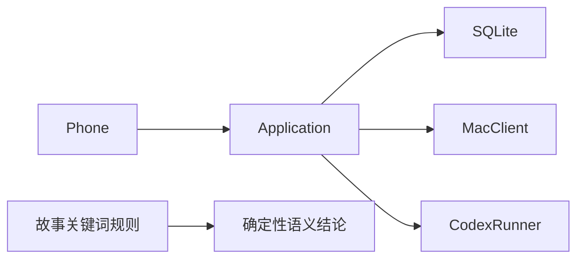
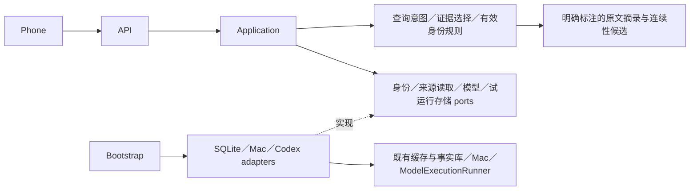

# 聊天记忆与历史回忆定向纠偏 — 2026-10-13

六项工程修复完成，隔离验收通过，可进入独立源码审核。真实模型理解、真实 Mac 链路和手机实机本轮未验；未部署、未启动历史重算。此前阶段报告可从 Git 历史查看。

## 基线、保护与版本

- ASR 最新 origin/master：`21fbf3c85d335f6c49e50d68c58d9d3db7fa5657`。
- Phone 最新 origin/master：`7d8684d6c63718abfd3b374ba5374a582e4ddc16`。
- 原工作区 HEAD：ASR `87532be77292e87cf70b36b60961b23f5d52c094`；Phone `c7b6fa8b8dc7ffa60e0a38b2321e3816589314b0`。原未提交修改留在原位，两端均用隔离 worktree / `codex/recall-corrections-v1`。
- ASR 0.8.1；Phone 1.0.14（1000014）；共享契约 3.12.0；讨论边界规则 3；答案提示 chat-answer-v3。既有 Core / Phone 数据迁移链不重建；聊天缓存按需增加失效水位表。
- Mac NO CHANGE：本轮未连接其仓库或服务，无法核验 Git SHA。试运行白名单、2026-10-16 00:00 Asia/Singapore 截止及生产状态未操作。

## 六项修复与验证

| 项 | 修复与验证 | 边界 |
|---|---|---|
| F1 | 删除招聘学科、选照片、登录、打光、报考等故事专用结论／分段规则。用回复边、时间间隔、共享原文片段、对象编号及指代提出连续性候选；保留人工决定。历史页刷新统一投影标题，避免无证据变化产生版本冲突。10 个冻结虚构语义样例保持否定、条件、转述、建议、承诺、取消、完成原文；相关／不相关讨论均有正反例。审计中的否定句不再变成“收到招聘消息”。 | 确定性记忆输出明确标为摘录；复杂语义归纳仅在用户按需查询、预算允许时由既有模型运行器处理。仅同义而无字面锚点的连续性仍可能漏召回，不自动确认关联。 |
| F2 | 完整问法规划为原话／原因／经过／后续四种意图；保留原问题，按完整话语片段及中文 2–4 字片段召回，SQLite 参数化精确匹配并排序。人物、账号命名空间、来源和日期过滤保留。6 个固定自然语言问题全部命中且进入模型输入。 | 短片段会增加噪声；无向量检索，纯同义改写没有字面重叠时仍有局限。 |
| F3 | 从命中集选择主要会话首尾、状态变化候选、相关性及时间跨度，选完再按时间排序。31 条中的末尾取消进入 20 条模型输入；本地 5 条旧命中仍核对来源并找到不含主题词的新后续，其他发言者仍独立归属。 | 来源覆盖未知或有后页时始终说明部分覆盖；不把最后可见记录等同当前最终决定。 |
| F4 | 打开原文确认修订／撤回也传播失效；清除依赖该证据的结论，保留审计片段。失效水位单调持久化，重启／旧修订重放不会复活旧证据；无关查询不清空。Phone 锁住同轮 stale，迟到分页不能恢复旧答案。离线保留带说明缓存。 | Mac 未报告的修订无法预知；远端版本落后只标不可用，不能据此覆盖本地较新版本。 |
| F5 | 原始 source_is_from_self 与有效 effective_is_self（true/false/null）分离；人工映射优先。纠正到他人为 false，解除后为 unknown，旧本人标记不重新吸收身份。冻结记忆读取时同样解析有效身份。 | 未确认录音保持未知；不改原文、原转写、声纹或训练样本。 |
| F6 | HistoryRecall 通过身份、来源存储、ChatDataSource、模型 ports 调用；MemoryTrial 的 SQL／回执读取移入 store adapter；bootstrap 组装 SQLite、Mac、Codex。 | API 路由和既有同步兼容；应用构造函数由 bootstrap 注入。原架构测试未修改、无新豁免。 |

## 调用图与规则范围

修复前：



修复后：



保留：账号命名空间、人工确认／拒绝／解除、引用边、时间边界、通用噪声／促销准入、附件脱敏、幂等与预算规则。删除：学科、物品、登录、照片等具体故事触发的标题、结论和对象分类。语言提示只用于检索与选择，不决定事实、人物或业务状态。模型只输出有引用的回答 JSON，无写任务、日历、关系或记忆的能力。

## 固定问题集与结果

冻结语料 `tests/fixtures/recall_corrections/frozen.json` SHA-256：
`87cc6150d2d95db6dc925a10d68114f90730d8400bd8aff258750a4a132b8762`。

同一虚构 SQLite 环境比较基线与修复版：正确证据召回 **4/8 → 8/8**，进入模型输入 **3/8 → 8/8**。前 6 问来自冻结集，后 2 项复现证据截断／未查后续。

| 查询 | 修复前召回／入模 | 修复后命中／取回／入模条数 | 总耗时 ms |
|---|---|---|---:|
| 软件工程 | 是／是 | 1／1／1 | 54.23 |
| 当初为什么不选软件工程来着 | 否／否 | 1／1／1 | 52.96 |
| 帮我回忆一下当时为什么考虑杭电 | 是／是 | 6／6／6 | 146.07 |
| 之前为什么考虑海洋测绘这个方向 | 否／否 | 1／1／1 | 46.73 |
| 星港展览筹备的事情经过是怎样的 | 否／否 | 1／1／1 | 51.87 |
| 星港展览后来怎么样，最终决定是什么 | 是／是 | 2／4／4 | 90.61 |
| 31 条证据中的末尾取消 | 是／否 | 31／31／20 | 380.97 |
| 本地 5 条旧消息＋来源新后续 | 否／否 | 5／6／6 | 129.44 |

必要的虚构依据示例：
- “因为软件工程的考试时间与实习冲突，所以当时没选。”
- “星港展览已经取消。”（第 31 条）
- “已经取消，请勿再订车。”（来源新后续；未映射的另一发言者，不能归为提问者决定）

修复后每场景调用引用测试桩 1 次，桩耗时四舍五入 0 ms；上述总耗时主要为隔离 SQLite 检索／校验。真实模型调用 **0**。桩只验证引用传输和原文校验，**不证明模型语义理解通过**。修复前失败已区分为检索失败 4 项、证据选择失败 1 项；真实模型理解未测，不能归因“模型效果不好”。

## 验收、预算与复现

- 最终相关 Python 组合：**187 passed / 27 warnings，43.92 s**；含原架构 4 项、跨仓库契约、桌面／设备接口、身份、试运行、记忆与查询。最后修复历史页标题引发的版本冲突后，受影响组合 **47 passed / 27 warnings，12.34 s**（与前组重叠，不相加），包含新增的版本稳定／真实变化正反例。warning 为既有 SQLite datetime 适配弃用提示。
- Phone 生产入口 ArkTS 构建成功；实际 UseCases＋隔离 ASR SQLite 桥接、失效／离线／迟到分页、历史页 reject/link/detach／重启／旧修订重放、跨天 SQLite/outbox 及内容脱敏测试通过。没有连接实机执行验收。
- 新文件及本轮完整整理的模块 Ruff 通过；未声称全仓库历史格式问题已清零。git diff --check 通过。
- 无答案、矛盾证据、伪引用、模型失败、来源离线、撤回、旧版本、解除、重复同步、重启、超时、取消、分页、人工状态和查询前后业务表不变均有测试；不是全部空答案／全部拒绝。
- 本轮生产原文读取 **0**，生产目录读取 **0**，生产业务元数据读取 **0**，真实 Mac 请求 **0**，真实模型调用 **0**，手机设备操作 **0**。仅虚构临时数据库；不扫描或复制生产主库。
- 运行时沿用：默认 30 天／最多 366 天；本地聊天／录音各最多 100 命中，显示最多 300 条、20 条一页；远端最多 6 请求／100 消息；模型至多 1 次／20 条证据；总查询 30 秒、单次 Mac 3 秒、模型最多 20 秒；取消及 5 分钟结果过期保留。到限返回部分覆盖。已有同步持久游标不变；一次回忆不自动启动续取或积压处理。
- 同类失败修复复测最多两轮：记忆分组回归两轮后通过；Phone 隔离依赖链接及 ArkTS 语法修复后通过；最后历史页投影版本冲突单独定位，一轮修复后通过。失败日志保留在本地审核包，未以删除门禁或新增豁免过关。

复现：设置本仓库及 `src` 为 PYTHONPATH，设置 `ALLDAY_HARMONY_REPO` 为配套 Phone checkout，运行本轮相关 pytest；核心新增验收为 `pytest -q tests/test_recall_corrections.py tests/test_history_recall.py tests/test_v3_architecture.py`。固定评测：

```text
python tools/evaluate_recall_corrections.py --checkout . --corpus tests/fixtures/recall_corrections/frozen.json --output outputs/evaluation.json
```

最少操作：部署配套版本后，在 Phone 原有「人物」或录音列表的「历史检索与回忆」输入问题，选择人物／日期／来源；按需核对来源开关控制有界取回。点依据验证原文，stale 时重新查询。关联、拒绝、解除仍在同一入口，不增加审核系统。**本轮无需用户为了测试聊天，也无需立即操作设备。**

审核包仅含两仓库代码差异、虚构评测、必要测试日志及复现说明，位于本地 outputs，不提交公开仓库。它供 ChatGPT 独立审核，未宣称独立审核已完成。真实语义质量仍需后续另行授权验证；`application/history_recall.py::_summarize` 能验证引用原文与结构，不能自动证明任意模型归纳的语义蕴含。`application/recall_retrieval.py::expand` 受来源接口和分页预算限制，仍可能漏掉预算以外的远处后续；页面明确显示覆盖不足。没有未解决的阻塞性工程测试失败。
